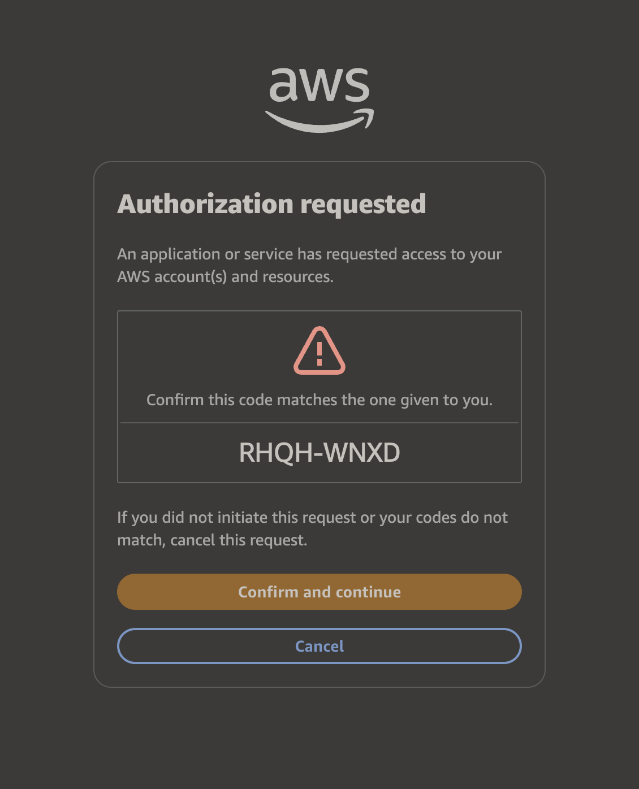

# AWS login

URLs:
- `https://*.awsapps.com/start/#/device?...`
- `https://*.awsapps.com/start/#/?clientId=...`
- `https://*.awsapps.com/start/#/?callback_url=...`

Also matches `clientId` and `callback_url` query parameters before AWS moves them into the `#` fragment.

Themes device authorization and OIDC authorization pages. The AWS access portal has its own dark mode.

