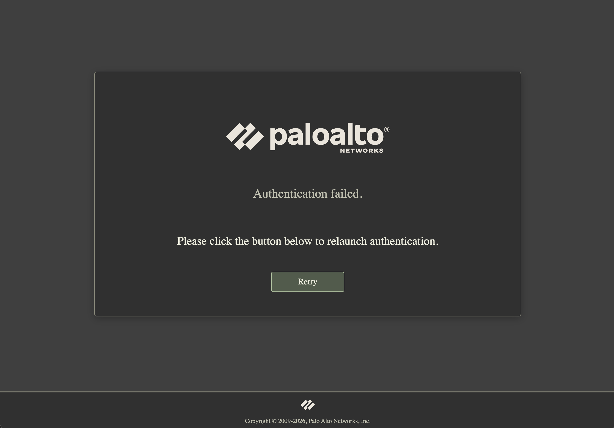

# Palo Alto Networks GlobalProtect

URL: `https://vpn.REDACTED.com/`

Replace `vpn.REDACTED.com` in `theme.css` with your portal hostname locally in Stylus. The theme applies to all pages on that host. Keep the actual hostname out of this repository.

Styles the authentication completion and failure pages. Logos are recolored cream for contrast.

