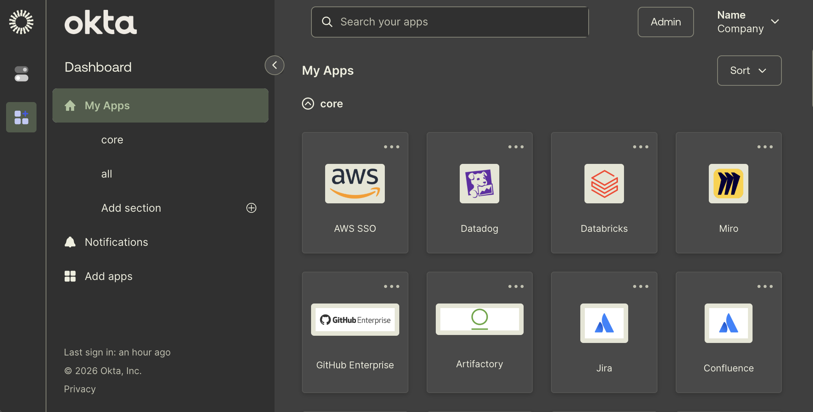

# Okta

URLs: `https://*.okta.com/app/UserHome*` and `https://*.okta.com/app/*/*/sso/saml*`

The CSS also themes the brief SAML signing-in screen, including its loading indicator. No companion script is needed for that screen.

The companion script themes Okta's sidebar and header inside open shadow roots, which Stylus cannot reach directly. Search and account controls blend into the page background. App logos retain their colors, with a cream backing for contrast.

The CSS and userscript match Okta tenants automatically; no tenant hostname needs to be configured or published.

See the [installation instructions](../../README.md#install) to install the CSS and userscript.
